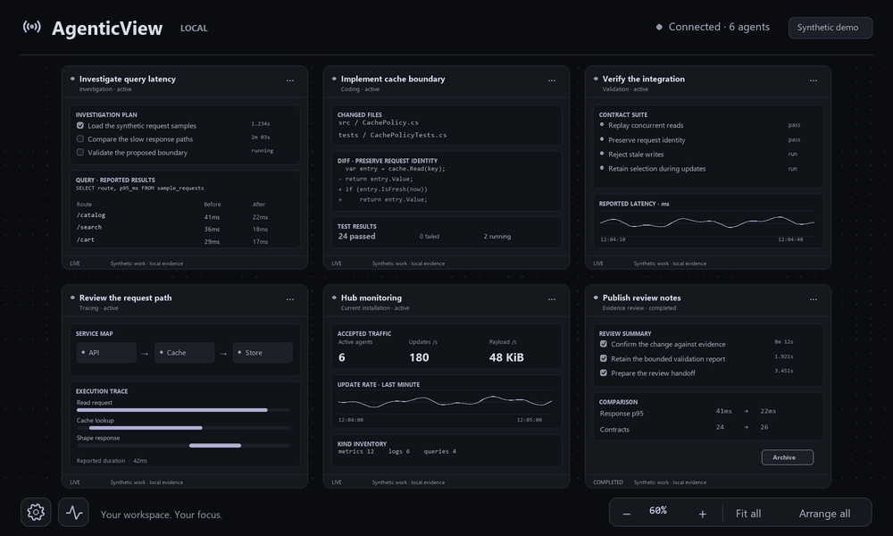

# AgenticView

**A calm canvas for live agent work.**

A self-hosted hub that brings agent plans, evidence and application controls into
one freeform workspace. Follow a run, inspect its children, keep useful results
in local archives, and build permanent consoles for your services and tools.



*Illustrative animation with synthetic investigation and coding data. [Generation source](scripts/render-readme-demo.py).*

C# · .NET 10 · React · MIT

[Get started](#get-started) · [Connect an agent](#connect-an-agent) · [Offline builds](docs/offline-build.md) · [Windows desktop](docs/desktop.md) · [Console updates](docs/console-update.md) · [View management](docs/view-management.md)

## A workspace that stays yours

- **Keep your place.** Pan and zoom around the canvas. Selected cards hold their
  position and size while reports arrive; new runs appear without moving your view.
  Arrivals pack around established cards. Use **Arrange all** to deliberately
  repack unlocked cards.
- **Stay responsive.** Unchanged card content is reused while you navigate and
  receive updates. Compressed assets and conditional caching reduce loading work.
- **Look closer.** Ordinary cards and nested components expand naturally. Large
  logs, paged grids and deliberate fixed views keep bounded scrolling. Mouse,
  keyboard and touch inputs share the same navigation model.
- **Choose the right view.** Use 40 built-in types: task lists, query results,
  commands, traces, charts, heatmaps, comparisons, code, diffs and more. Native
  components handle display and interaction; custom HTML is an escape hatch with
  a distinct frame and **Custom view** label. See the [native catalog](docs/native-components.md).
- **Follow the work.** Declared child agents stay with their parent. Status colors,
  first-visible arrival cues, timestamps and compact elapsed task durations make
  changes easier to scan. Exact observed times remain available on hover.
- **Keep the evidence.** Completed cards archive after a configurable review delay,
  five minutes by default. Review and restore them in the draggable **Archived
  cards** browser. Permanent launchers remain visible.
- **Watch the hub.** The monitoring icon beside settings opens a world card with
  agent counts, update and payload rates, recent curves, component activity and
  server health. Larger working text stays within the existing card sizes.

- **Compose compact GUIs.** Plain native surfaces and inline layouts support small
  icon actions, text fields, dropdowns, toggles and grids without decorated subcards.
  See [compact configuration](docs/configurable-components.md#compact-native-guis).
- **Inspect execution.** A compact native forex example links strategy/order/trade
  hierarchy to bid/ask prices and status events, with configurable Graphite, Paper
  and Terminal styles. Cards can pop out into independent Windows processes for
  manual taskbar pinning. See the [forex workbench](docs/forex-workbench.md).
- **Talk back.** Add buttons, prompts, forms, selects and toggles with optional
  inline confirmations. Agents consume an action inbox; .NET connectors execute
  locally configured commands on the machine with access.
- **Keep your sessions.** Open prompt cards for local or SSH agents, follow rich
  output and reported components, pause/resume and recover interrupted work in
  the same card. Agents can prepare machines, reusable encrypted logins and
  launcher recipes through MCP. See the [session guide](docs/sessions.md).
- **Reconnect without duplicate cards.** External agents can retain their native
  provider/session identity and private registration proof to reuse their card,
  components and layout across reconnects. See [session registration](docs/view-management.md#stable-native-session-registration).
- **Keep an application.** Permanent cards outlive their creating agent. Follow
  bounded log tails or page through millions of source rows. Generic add/edit/delete
  callbacks send full rows to your scripts or services; persistence and history
  belong to your adapter. See [application cards and controls](docs/controls.md).
- **Share the application.** Agents can keep versioned `.agenticview.json`
  definitions in their own repositories. Import them through an agent or the
  settings card, binding reusable controls to local workers. Definitions exclude
  installed credentials and automatically captured telemetry. See
  [portable applications](docs/applications.md).
- **Manage the whole view.** Authorized operator MCP tools can read other cards,
  change settings and layouts, restore archives, and create standalone native
  components. Operator access requires the viewer credential; ordinary run and
  session tokens retain their scope. See [view management](docs/view-management.md#operator-mcp-capability).
- **Keep summaries current.** Optional quick-text actions route bounded card
  context to a configured agent inbox or connector for titles, summaries or
  component text. Schedules support cancellation, deadlines and explicit failure
  states. See [quick-text actions](docs/view-management.md#optional-quick-text-actions).

AgenticView has no LLM dependency. The hub records and routes configured actions;
execution belongs to the owning agent or a connector with local profiles.

## Four simple concepts

| Concept | What it means |
| --- | --- |
| **Run / card** | One registered agent execution, with its own identity, status and live view. |
| **Native subcard** | A typed component inside a run: a plan, metric, table, log, diff or other evidence. |
| **Declared child** | Another run registered with its parent's proof, shown inside the parent card. |
| **Archive** | A compressed snapshot of the retained run, stored locally for later inspection or restoration. |

Arrival, update and completion times describe when reports were observed. Task
rows retain observed start and completion timing as their checkboxes change;
existing work does not acquire an invented history.

## Get started

For connected development, install the **.NET 10 SDK**, **Node.js 24+** and
**pnpm 11.25.0**, then run from the repository root:

```sh
pnpm install --frozen-lockfile
pnpm build
pnpm start
```

In another terminal, from the same directory and with the same `AV_DATA_DIR`:

```sh
pnpm keys
```

Open [localhost:4317](http://127.0.0.1:4317) and sign in with the viewer key. Give
agents the ingestion key; keep the server's `runSecret` private.

**Keep me signed in on this device** is enabled by default and saves your sign-in
for one year in the same browser or desktop profile. Uncheck it for a browser
session lasting up to 12 hours. **Settings → General → Sign out** clears the saved
sign-in. The viewer key is exchanged for a protected HttpOnly cookie and is never
stored in page scripts or browser local storage.

For frontend development, run `pnpm dev` and `pnpm dev:web` in separate terminals.
`pnpm check` and `pnpm test` run the project's checks.

### Build on an offline Windows machine

Prepare an [offline source bundle](docs/offline-build.md) on a connected machine.
It contains the locked NuGet packages and prebuilt browser assets. After
transferring and extracting it on **Windows x64 with the .NET 10 SDK installed**:

```powershell
powershell -NoProfile -ExecutionPolicy Bypass -File scripts/build-offline.ps1
dotnet app/AgenticView.Server.dll
```

The offline build needs no Node.js or internet package restore. Web changes are
built during bundle preparation. See the guide for key retrieval and verification.

The optional [Windows host](docs/desktop.md) opens a dedicated fullscreen window
with custom controls and the same signal icon as the web title. It requires the
Windows Desktop and WebView2 runtimes; closing the window leaves the server running.

### Update an existing console

The [console updater](docs/console-update.md) stages a hash-verified runtime ZIP
from a local file or an existing outbound SSH route before an explicit Apply.
It checks managed session activity, retains generated-output backups, and updates
the owned hub and desktop using their existing data and private desktop profile.
Startup receipts retain process identity and latest data when recovery needs
inspection. Pause or finish sessions and prevent concurrent new actions while
applying; these preflight checks are not an atomic maintenance lock.

The Windows deployment helpers use PowerShell 7.2+. Apply additionally needs an
existing Python 3.10+ interpreter with SQLite JSON support for read-only session
inspection; this is a deployment tool, not a server dependency.

### Optional subscription connection controls

A separately prepared gateway can expose **Connect Codex subscription** and
**Check connection status** through a configured connector. Existing launchers
use a permanent child utility so their saved session action versions stay intact.
Importing or attaching the controls starts neither OAuth nor inference; Connect
is an explicit action, and Status reads local metadata only.

The examples do not install a gateway or establish subscription compatibility.
See [subscription setup](docs/subscription-setup.md) for prerequisites, portable
templates and the separate authentication cache.

## Connect an agent

Connect through **MCP over Streamable HTTP** at `/mcp`, or use the HTTP API.
MCP exposes `component_catalog`, `agent_register`, `agent_publish`,
`agent_heartbeat` and `agent_archive`.

After [registering a run](docs/protocol.md), send a batch like this to
`POST /api/agents/{runId}/publish`, using the run's private token in an
`Authorization: Bearer <runToken>` header:

```json
{
  "sequence": 1,
  "operations": [{
    "op": "upsert",
    "component": {
      "id": "plan",
      "title": "Current work",
      "kind": "markdown",
      "data": { "text": "- [x] Inspect the inputs\n- [ ] Validate the result" }
    }
  }]
}
```

Batches are atomic and sequenced. Retry an uncertain delivery with the same
sequence and body. The [protocol](docs/protocol.md) covers authentication,
heartbeats, child registration and cleanup. Start from the
[TypeScript client](clients/client.ts) or the [language examples](examples).

## Local by default

The server binds to `127.0.0.1:4317`. `AV_DATA_DIR` selects its local database,
archives and credentials; use separate data directories for separate installations.
Remote access requires an explicit public URL and HTTPS, or an explicit trusted
private-network HTTP configuration. See the [deployment design](docs/design.md).

Viewer access, installation ingestion and individual run writes use separate
credentials. Agent content remains untrusted. Embedded views have a sandboxed,
state-only bridge, and settings can pause them.

Archives preserve retained content, including reported append trimming. They are
snapshots of a run's current evidence rather than an unlimited event history.
Published source and examples contain synthetic data only.

[Architecture and design](docs/design.md) · [Measured workloads and limits](docs/performance.md) · [MIT license](LICENSE)

See [component configuration](docs/configurable-components.md) and [card controls and layout](docs/control-presentation.md) for MCP and manual presentation settings.
