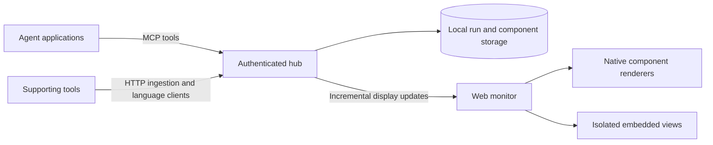

# AgenticView design brief

This is a design document, not an implementation or a claim of tested capacity.
The requirements below are agreed; sections marked **Proposed** remain design
recommendations until resolved.

## Agreed product

AgenticView is a public MIT project for observing agents across applications and
machines. One self-hosted hub serves one operator and its web monitor. Independent
installations keep different environments separate. Archives live in the local
installation. The first version observes activity; it does not control agents.

The monitor starts empty on a dark background. Connected agents publish context,
activity, and components into their own cards. Orchestrators declare child agents,
forming nested cards. Viewers can lock cards while the surrounding layout adapts.
Completed or expired runs move into an archive.

The initial priority is investigation work: query execution and results, evidence,
logs, file listings, code and diffs, branch and build information, and connection
activity. Games and simulations should use the same extensible display protocol.
Agent-provided views supplement the native structured component catalog.

## Proposed system boundary

Both ingress paths validate the same versioned contracts and call the same
application services. Agents decide what information to publish; the hub does not
connect to databases, file shares, build systems, or remote shells on their behalf.
Installation credentials and telemetry never become repository content.

Credentials need explicit producer and run ownership scopes. An ingestion
credential must not grant dashboard access or authority over unrelated producers.
Child declaration and claim permissions follow the same ownership boundary;
shared display names or possession of an installation URL confer no authority.

**Proposed:** a TypeScript service and web client, served together, with a local
SQLite store. The implementation choice must be checked against the selected
load target before any capacity is advertised. Direct HTTP ingestion keeps C#,
PowerShell, and Python integrations independent of an MCP-capable host.

Remote MCP uses Streamable HTTP. Dashboard update streaming is a separate channel;
an MCP connection is not itself an agent heartbeat. Validate origins, bind to
loopback by default, and require explicit configuration and authentication before
accepting remote clients. See the [MCP transport requirements](https://modelcontextprotocol.io/specification/2025-11-25/basic/transports).

## Proposed identity and lifecycle

Keep three identities separate:

| Identity | Purpose |
| --- | --- |
| Agent identity | A logical producer, independent of a network connection |
| Run identity | One execution, with a beginning and terminal outcome |
| Connection identity | A replaceable transport session |

A reconnect resumes the same nonterminal run; a new execution creates a new run.
Server receipt time determines liveness. Client timestamps remain useful event
metadata, but clock skew must not make a run expire.

**Proposed defaults:** agents send a heartbeat every 15 seconds. A run becomes
visibly stale after 45 seconds without contact and is archived after 5 minutes.
Explicit completion archives immediately and records its outcome. These are
configuration values, not constants in the display contract. Archive retention
and deletion policy remain pending.

Archive placement and execution outcome are separate fields. A run moved into
the archive for lost contact has an unknown outcome and may return to the live
view when the same authenticated run reconnects. Only explicit completion makes
the execution terminal. Retention expiry can remove the ability to resume an old
run; the producer then starts a new one instead of reusing its identifier.

Network silence means lost contact, not proven process death. Terminal runs cannot
be resurrected by delayed messages. Reconnects use stable run IDs and revision
cursors; mutation retries use idempotency keys or sequence numbers scoped to the
authenticated producer and run.

An orchestrator declares a child before that child claims the declaration with
appropriate credentials. Reject cycles, duplicate parents, and unauthorized
reparenting. A parent's failure does not expire independently active children.
Keep their ancestry visible when the parent is archived. Reusable display names
must not act as authentication identities.

## Proposed component contract

Each component has a stable ID within its run, a schema version, a kind, a title,
a revision, and typed content. Agents publish semantic content and display hints;
the viewer owns screen coordinates, locks, focus, and expansion state.

| Family | Planned native displays |
| --- | --- |
| Summaries | Metric cards, trends, status, progress, gauges |
| Series | Line, area, bar, scatter, histogram, heatmap |
| Structured data | Tables, key/value details, JSON inspector, trees |
| Narrative | Markdown, plain text, callouts, evidence references |
| Engineering | Code, diffs, logs, query text and tabular results |
| Activity | Event timeline, build and connection status |
| Relationships | Agent hierarchy, graphs and flow diagrams |
| Extensions | Agent-authored embedded views with scoped input data |

This is a product catalog, not a statement that every renderer ships in the first
release. The first end-to-end implementation should cover agent trees, status,
Markdown, logs, tables, metrics, charts, code/diffs, and a timeline, then extend the
same registry. Unsupported versions or kinds need an explicit inspectable fallback,
never silent content loss.

Support replacement, bounded append, and removal without retransmitting a whole
card. Define ordering, duplicate handling, per-kind retention, payload limits, and
component limits in the published protocol. Reject an invalid mutation atomically
with an actionable error. No arbitrary code belongs in a native component.

## Proposed embedded-view rules

Generated views must not inherit the dashboard's credentials, DOM, storage, or
authority. Scope each view to explicitly selected data from its own run.

**Proposed baseline, pending a trust-model decision:**

- Render embedded content in a sandboxed browsing context with its own origin
  boundary. Do not combine script execution with same-origin privileges.
- Decide between an opaque-origin frame and a dedicated serving origin before
  implementation. Package the HTML and its dependencies with bounded size and
  explicit allowed types; do not resolve arbitrary agent-supplied asset URLs.
- The hub owns the sandbox attributes, response headers, and outer wrapper. An
  agent cannot weaken that policy through component fields or its own markup.
- Expose a small, versioned message bridge for initial state and updates. Validate
  message schema, source window/channel, data size, and lifecycle before acting.
  Each authorized document receives a fresh bridge session. Navigation or reload
  invalidates that session; window identity alone cannot authorize a new document.
- Never pass access tokens, arbitrary cross-run data, or privileged host APIs into
  a view. The observation-only bridge cannot issue agent commands.
- Restrict subresource and API requests with a Content Security Policy. Do not
  enable external scripts, forms, popups, downloads, camera, or microphone by
  default. Bundled dependencies need an explicit packaging policy.
- Lazy-mount expensive views and provide a way to pause or remove a view that
  becomes disruptive. Browser rendering is not a hard CPU or memory quota.

Sandboxing and CSP are layers of browser isolation, not a promise of complete
network containment for arbitrary hostile JavaScript. In particular, fetch
restrictions must not be presented as covering every navigation or side channel.
If hard network denial is required, select an execution model that can enforce it
before enabling arbitrary code. See the [iframe sandbox documentation](https://developer.mozilla.org/en-US/docs/Web/HTML/Reference/Elements/iframe)
and [CSP reference](https://developer.mozilla.org/en-US/docs/Web/HTTP/Reference/Headers/Content-Security-Policy).

Executable embeds ship only after the selected trust and network policy has an
enforceable implementation. Until then, embedded payloads can be inspected as
source but cannot execute. Bridge capabilities, external network policy, and code
trust are separate dimensions that must all be specified.

Native Markdown is sanitized and never doubles as the executable embed mechanism.

## Proposed live-update and storage behavior

Maintain bounded server state and publish incremental changes to subscribed
viewers. A slow viewer must not block ingestion or accumulate an unbounded queue.
Keep a revision cursor; a viewer that falls outside the retained change window
gets a fresh snapshot rather than an incomplete replay.

Metric samples may be coalesced for rendering, while explicit events and accepted
archive data follow a separately documented persistence policy. Do not claim
lossless historical capture merely because the latest state is correct. Under
pressure, reject work with an explicit retry response or disclose a documented
aggregation policy. Never silently drop accepted evidence.

Bound chart history, paginate tables, virtualize long logs, batch incoming changes,
and render only affected visible content. Layout should remain stable while
agents join and leave. Reduced-motion preferences and keyboard access apply to
both cards and their controls. Pinning and focus must survive unrelated updates.

## Remaining design decisions

1. Embedded-code trust model: restricted data bridge, allowed external sources,
   or a more trusted execution mode; define what isolation can be guaranteed.
2. Main layout: stable grid, freeform canvas, or both; define exactly what a lock
   preserves and whether it is per browser or shared across the installation.
3. Performance target: active agents, updates per second, typical payload size,
   simultaneous viewers, and history volume; establish reproducible workloads.
4. Lifecycle and retention defaults: automatic retirement, retention duration,
   manual deletion, and export behavior.

## Delivery and validation

Start with one real path: an authenticated agent registers, declares a child,
publishes multiple native components, reconnects without duplication, and retires;
the monitor updates and an archive survives a service restart. Provide synthetic
HTTP and language examples before expanding integrations.

Validate authentication boundaries, contract errors, replay/idempotency, hierarchy,
liveness, persistence, stream backpressure, and component behavior with meaningful
non-image checks. No automated screenshots, image comparisons, raster assertions,
or image-based acceptance. Visual review is manual. Load claims require measured
results on a stated machine and workload; polish claims require an actual UI.
