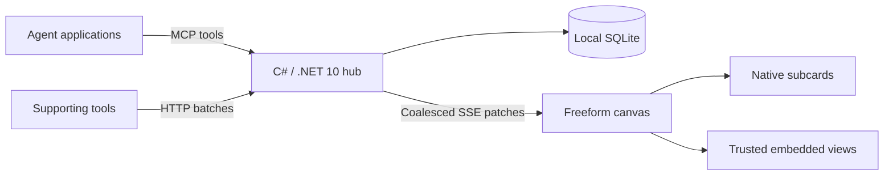

# Design

AgenticView is a self-hosted, single-operator observation hub with a **C# / .NET 10
server** and React monitor. Investigations are the first use case. Independent
installations separate environments. No server-side LLM interprets display content.

## Canvas and lifecycle

The monitor opens empty on a dark freeform world. Agent cards cannot overlap.
Dragging resolves free positions around obstacles; locks hold positions fixed.
Cards grow with content or use manually resized fixed viewports. A locked card
that cannot grow safely scrolls internally. Native displays are titled subcards
inside the agent: Markdown plans, diffs, modified-file trees, metrics, and evidence.
Task lists and current plans always lead each agent card, including nested cards,
before context, children and supporting evidence. Markdown checklists are detected
from their task syntax; Markdown or tree components named `plan`, `tasks` or `todo`
in their ID or title also receive this priority. Other components keep arrival order.

All unlocked world cards participate in automatic bin packing, including legacy
and manually sized cards. Arrivals favor older valid positions and fill available
gaps. Removals and size changes trigger compaction; Arrange all compacts explicitly.
Sizes and position locks are preserved. Active moves/resizes hold temporary
reservations so concurrent layout updates cannot move the card under the pointer.
The chosen packing footprint persists across restarts.

Mouse, keyboard, and touchscreen input share the same camera transforms. Pinch
zoom preserves the world anchor under the fingers while midpoint motion pans.
Fit all has no fixed zoom floor. Visible cards retain their content at every zoom
level; double-click or double-tap focuses a card. Editing controls retain their
normal key and tap behavior. Embedded documents start behind a navigation surface;
choose **Interact with view** in an active card to use their own controls. Return to
card navigation with the same button. Deactivation or canvas navigation resets this
mode. The document remains isolated and never receives dashboard credentials.
Fit all follows arriving cards and layout changes until you pan, zoom, or move a
card. In a custom viewport, an offscreen arrival offers a persistent Show card action.

Canvas navigation has priority until a card is clicked, tapped, or activated with
Enter. Active cards expose independent content zoom and bounded native scrolling;
zoom-out stops at content fit and panning cannot leave the scroll range. Escape returns to
canvas navigation. Space-drag, middle-drag and Alt gestures force the canvas.
Main zoom, Fit all, Arrange all and settings remain authoritative in a viewport
HUD outside the transformed world. Larger system text uses the existing card
dimensions and component spacing, with internal panning where needed.
Wheel and drag gestures consume nested grid, log, code and child-card scroll ranges
first, then continue with the remaining movement in the containing card. Reversing
direction scrolls the nearest region first. Ctrl/Command-wheel and two-finger pinch
zoom the active card before component handlers can consume them.

The optional C# Windows desktop host opens the monitor in a dedicated fullscreen
WebView2 window with no system title bar. Custom top-right controls minimize,
restore/maximize and close it. See [desktop setup](desktop.md).

Orchestrators declare children, which appear as nested agent cards. Surviving
children become independent world cards when their parent is archived, retaining
ancestry. Independent sizing controls currently apply to world cards; nested
children use contained content and scrolling.

Archives can be restored from the settings card. A valid agent content update also
restores its archived card, preserving identity and retained content. Heartbeats
leave archives in place. Restored cards move only when their saved position is occupied.

One bottom-left cog opens a settings card in the world. It holds preferences,
archives, and connection guidance. Agents own cleanup: remove components, clear,
or archive their run. Heartbeats are recommended every 15 seconds; the stale
indicator defaults to 45 seconds. Silence does not prove process death.

Automatic inactivity and completion archiving are optional and off by default.
Archives preserve the current view with gzip compression. They remain locally
available for inspection and export. Completed runs accept cleanup but cannot
become active again; archived executions use a new registration for later work.

## Server and contracts

Agents publish selected observations from systems they already access. The hub
validates, persists, and displays that content. The official C# MCP SDK provides
Streamable HTTP. Direct HTTP calls use the same application services.

The server has two direct NuGet dependencies: the MCP SDK and SQLite. Their full
transitive graph is locked. The offline source bundle carries every package and
prebuilt web assets, allowing work builds with the .NET 10 SDK alone.

An agent identity is a logical producer; a run is one execution; a transport
connection is replaceable. Registration retries require an idempotency ID and the
same private random recovery proof. Children also present a parent run token.
Display names do not authorize writes.

The installation ingestion key permits registration and MCP access. Run write
tokens derive from a separate server-only secret. Viewer credentials are separate.
The monitor uses HttpOnly, SameSite Strict cookies. Host and Origin checks reject
unexpected browser origins, including `Origin: null`.

Atomic batches use consecutive sequence numbers. The last 256 digests permit exact
retries; conflicting or unverifiable old batches fail. The TypeScript client
retains uncertain content and reconciles it before sending another batch.

## Display content

The [schema](../shared/components.schema.json) defines 14 kinds: metric, chart,
table, Markdown, code, diff, logs, timeline, progress, key/value, JSON, tree, status,
and embed. Charts support line, area, bar, and scatter. Stable component IDs permit
replacement, removal, and bounded appends.

Trusted embeds can execute scripts and load external resources. Authenticated
documents have an opaque-origin sandbox and response CSP. A fresh MessageChannel
supplies only their component state. Independent navigation revokes the bridge.
No host credentials, cross-run data, or command API is provided. Archived embeds
are paused. Native Markdown does not execute raw HTML. Browser sandboxing does not
provide hard CPU, memory, or network quotas.

## Efficiency and validation

Validated state is committed to SQLite before acknowledgement. Display changes
coalesce every 100 ms. Slow viewers disconnect and reconnect with a full snapshot.
The canvas culls offscreen world cards, tables paginate, logs window their visible
range, and native renderers are memoized.

Bounds: 1 MiB requests, 64 components/2 MiB per live run, 128 MiB total serialized
live state. The target is 1,000 active agents and 10,000 operations per second.
Measurements must state payload mix, batching, viewers, runtime, warmup, and
duration. Synthetic ingestion does not establish browser frame rate. Node backend
prototype measurements do not apply to C#.

Checks cover credentials, atomicity, retries, hierarchy, persistence, compression,
streaming, geometry, and semantic rendering. No image or screenshot acceptance is
automated. Manual visual review remains separate.
